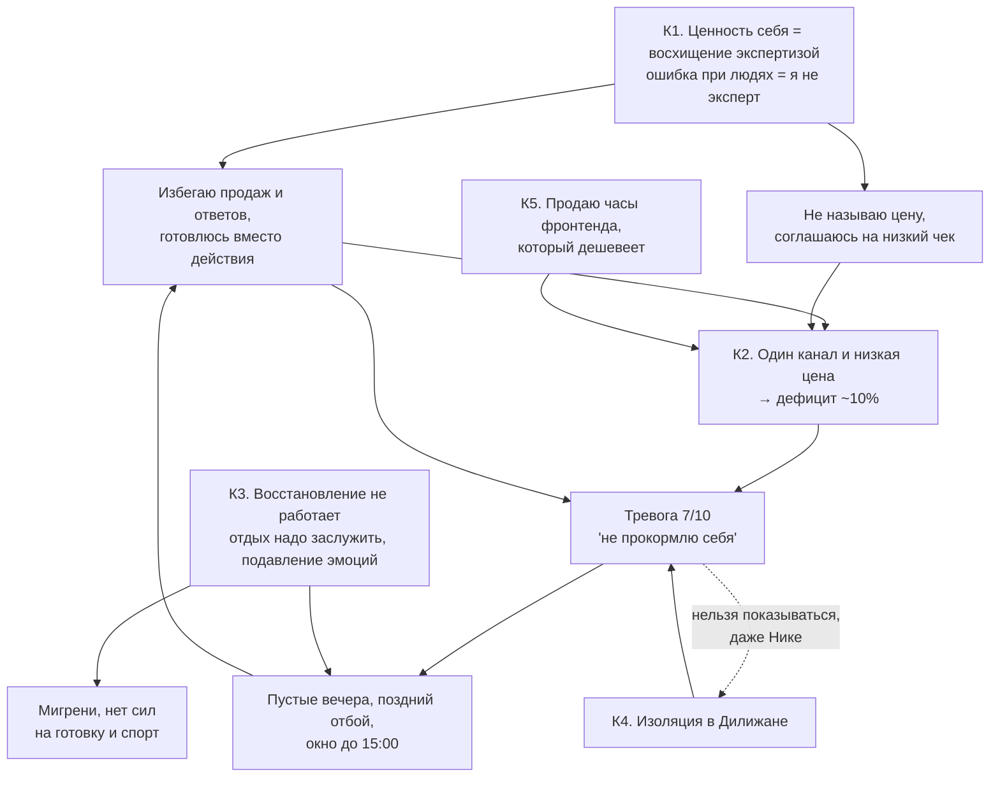

---
tags:
  - mark/addition/practice
status: 🟩
source:
  - "[[Стратегия без иллюзий_ Как управлять своей жизнью, чтобы обрести устойчивость и достигать большего в условиях перемен]]"
description: "Задание 3: собрать проблемы из оценки текущей ситуации и отделить корневые разрывы от симптомов"
summary: "Корни: страх оценки (К1), доход ниже расходов (К2), фронтенд дешевеет (К5). Решение: сначала найм с позиционированием фронтенд + ИИ, новая ставка текущим клиентам; критерии к 20.11."
icon: 💪
color: "#7cbf7a"
created: 2026-11-03T10:30:09+04:00
updated: 2026-11-03T10:53:47+04:00
---

> [!toc]+
> ```table-of-contents
> ```

Продолжение [[оценка текущей ситуации]] по разделу "Поиск и анализ стратегических разрывов" из [[Стратегия без иллюзий конспект|конспекта]]. Определения: [[стратегический разрыв]], [[маркеры стратегических разрывов]].

## Задание

Пройтись по анализу текущей ситуации и собрать все проблемы. Проследить причинно-следственные связи и найти корневые проблемы, а не симптомы. Всё, что похоже на барьер, ограничение, негативное явление или просто "неприятное чувство", – потенциальная проблема.

- **Разрывы устойчивости** мешают нормально жить прямо сейчас: деньги, здоровье, энергия, время.
- **Разрывы развития** отделяют меня сегодняшнего от меня из [[Формирование желаемого будущего|образа будущего]].

Важно отличить симптомы, составные части одной проблемы и повторы от корневых проблем.

## Шаг 1. Сбор проблем по блокам

> [!todo]- Ответы 2026-11-03: гипотезы
> Всё взято из [[оценка текущей ситуации]]. Номера `П1…` нужны для шага 2. Вычеркни то, что не про тебя, и допиши пропущенное.
>
> **♦ Дашборд состояния жизни**
> - П1. Расходы выше доходов второй месяц: ~293 500 против ~267 000 драм, дефицит ~10% ([[Месячный бюджет]]).
> - П2. Поиск клиентов на 1–2: демо собрано, разослано мало.
> - П3. Тревога 7/10, мысль "неспособен себя прокормить" ([[periodic/daily/2026-10-30|30.10]]).
> - П4. Режим сбит 4 дня из 6, подъём в 7:00 не держится ([[periodic/weekly/2026-W44|W44]]).
> - П5. После 15:00 продуктивность падает, рабочее окно короткое.
> - П6. Сильное одиночество каждый день, кроме воскресенья ([[periodic/daily/2026-10-29|29.10]]).
> - П7. Близость с Никой на 2: она далеко, неизвестно, приедет ли.
> - П8. Удовольствий нет, вечерний отдых "пустой".
> - П9. Готовка и закупки вызывают "жёсткий стресс".
> - П10. Силовых тренировок нет с 01.10.
>
> **♦ Фокусы внимания**
> - П11. Самый большой фокус – тревога о деньгах (●●●●○), а поиск клиентов – самый маленький (●○○○○).
> - П12. Пассивное ожидание ответов заказчиков без напоминаний.
> - П13. Хранилище и свои системы в рабочие часы.
> - *Почему от тревоги нельзя отказаться:* её не выбирают, а действие, которое её снимает, страшное. *Почему нет фокуса на важном:* важное = продажи = оценка меня.
>
> **♦ Опыт и навыки**
> - П14. Повторяющийся провал: бросаю то, где меня оценивают и нет внешней даты. ЕГЭ весной, 200+ откликов на Java и стоп, пары без подготовки, не отвечал Гале, не ответил людям в Threads ([[мой паттерн провала]]).
> - П15. Подменяю действие подготовкой: 4 книги о доходе и 0 сообщений клиентам в октябре.
> - П16. Не договариваюсь о деньгах заранее: [[Avito accounts]], Sladko не оплачен до приёмки.
>
> **♦ Майндсет**
> - П17. Умом установка роста, чувствами фиксированная: критика – удар, ошибка – угроза.
> - П18. "Ошибиться при людях = доказать, что я не эксперт".
> - П19. "Мои результаты не считаются" ([[паттерн недоприсвоения результатов]]).
> - П20. Лимиты Claude как способ отложить страшный ответ.
>
> **♦ Сильные и слабые стороны**
> - П21. Боюсь выглядеть непрофессионально ([[periodic/daily/2026-10-02|02.10]]).
> - П22. Работаю до перегруза, вечером "заебался".
> - *Сильные стороны, которые не используются:* разбор чужого хаоса и объяснение сложного – готовый материал для консультаций, а продаю только часы вёрстки.
>
> **♦ Окружение**
> - П23. В Дилижане нет ни одного своего человека.
> - П24. Весь платный поток идёт через один канал: Асташко и Сергей, плюс бартер с Maxwell через Кирилла.
> - П25. С Никой не говорю о деньгах.
> - П26. Общение с мамой выжимает, её номер недоступен.
>
> **♦ Обязательства и активы**
> - П27. Аренда 44% и коммуналка 18% расходов, зимой коммуналка вырастет.
> - П28. Кредит 44 000 в месяц. Условия кредитки, которая служит резервом, не выяснены.
> - П29. Психолог "не влезает" в бюджет, но это обязательство.
> - П30. Внутренние обязательства: "должен сам себя прокормить", "обязан вывезти Нику", "отдых надо заслужить", "нельзя подвести единственный канал", "нельзя показываться настоящим".
> - П31. Низкие чеки "чтобы не потерять канал".
> - П32. Активы простаивают: люди из Threads, армянское ИП, демо из [[Career advancement]].
>
> **♦ Мотивация**
> - П33. Запускают только давление и даты, продажи – только под стимулом "не прокормлю".
> - П34. Конфликт ценностей: деньги 2 / 3, а Смелость в отстаивании взглядов 17 / 2. Первые средства – Чуткость, Терпимость, Воспитанность: чтобы другим было удобно.
> - П35. Самоконтроль 10 / 8 оборачивается подавлением аффектов, а оно связано с мигренями.
> - П36. Ценности-надзиратели: Продуктивная жизнь, Высокие запросы.
> - П37. Английский: цель или инерция, неясно.
>
> **♦ Видение будущего**
> - П38. Код-агенты почти решают типовые задачи ([[Карта трендов]]). Мой доход сейчас – часы фронтенда, то есть ровно то, что дешевеет.
> - П39. Шаблоны и мини-курсы обесцениваются: продукт "сделал раз, продаю вечно" не сработает.
> - П40. Свобода интернета падает, у российской аудитории всё меньше доступа.

## Шаг 2. Чистка: симптомы, части, повторы

> [!todo]- Ответы 2026-11-03: гипотезы
> | Что                                                                       | Тип                                 | Куда сводится                                                                                                                   |
> |------------------------------------------------------------------------------|----------------------------------------|---------------------------------------------------------------------------------------------------------------------------------------------|
> | П3 тревога, П11 тревога как главный фокус     | симптом                         | следствие К1 и К2: тревога растёт от пассивности ([[пассивность усиливает тревогу]])            |
> | П2, П12, П14, П15, П20, П21                                            | части одной проблемы | избегание оценки – К1                                                                                                      |
> | П17, П18, П19, П30 "нельзя показываться"               | корень этой группы     | установка про ценность себя – К1                                                                                  |
> | П16, П31, П34                                                             | части одной проблемы | не называю цену – К1 в денежной форме                                                                          |
> | П1, П24, П27, П28                                                        | узел                               | дефицит – К2; он вытекает из К1, но живёт и сам по себе                                              |
> | П4, П5, П8, П22, П30 "отдых заслужить", П35, П36        | части одной проблемы | восстановление не работает – К3                                                                                   |
> | П9 готовка, П10 силовые                                      | симптомы                       | выпадают, когда нет энергии – К3                                                                                   |
> | П6, П7, П23, П25, П26                                                   | части одной проблемы | изоляция – К4                                                                                                                     |
> | П13 хранилище в рабочие часы                           | симптом                         | единственное место без оценки и с удовольствием, туда бежишь от К1 и К3             |
> | П33 запуск только давлением, П37 английский | связано                         | К1 + К3: без удовольствия и с внутренним надзирателем остаётся только стимул   |
> | П32 простаивающие активы, П38, П39                     | разрыв развития          | К5                                                                                                                                         |
> | П29, П40                                                                   | внешнее, принять         | психолог – вложение, не резать; интернет-свобода – учитывать в выборе канала |

## Шаг 3. Причинно-следственные связи



> [!todo]- Ответы 2026-11-03: гипотезы
> - **Главная петля:** К1 → избегаю продаж → денег мало → тревога → вечер съеден → завтра снова нет сил на страшное. Тревога – не причина, а топливо петли.
> - **Где её рвать.** Не в тревоге, её не выключить. Рвать в звене "избегаю": одно сообщение до обеда дешевле, чем вечер тревоги. Это уже подтверждено фактом: "сел за подготовку – и вся тревога пропала" ([[periodic/daily/2026-10-22|22.10]]).
> - **К3 питает петлю сбоку.** Без восстановления окно до 15:00, а продажи – самое энергозатратное дело, поэтому они выпадают первыми.
> - **К4 усилитель.** Тревогу не с кем разделить, а с Никой о деньгах я молчу. Так установка "нельзя показываться" из К1 сама создаёт изоляцию.

## Шаг 4. Корневые разрывы

> [!todo]- Ответы 2026-11-03: гипотезы
> ### Разрывы устойчивости
> 1. **К2. Доход ниже расходов, один канал, низкая цена.** Прямо сейчас ~26 000 драм в месяц, а для переезда Ники нужно +46 000. Деньги – ценность №2, ощущается на 3. *Самый срочный.* Точка решения 20.11 (пятница) из [[оценка текущей ситуации#Путь к материально обеспеченной жизни|пути к обеспеченной жизни]].
> 2. **К1. Страх оценки и привязка ценности себя к экспертизе.** Корень К2, а ещё английского, ЕГЭ и откликов на Java – повторяется много лет. *Самый глубокий.* Внешняя опора – психолог; внутренняя – правило "счёт за неделю, а не исход одного диалога".
> 3. **К3. Восстановление не работает.** Отдых "надо заслужить", эмоции подавляются, удовольствий нет. Отсюда короткий день, сбитый режим, мигрени. Ценность Здоровье – 3 / 6. См. [[легитимизация отдыха]], [[Лечение мигрени]].
> 4. **К4. Изоляция.** Ни одного человека в Дилижане, Ника далеко, с мамой тяжело. Усиливает тревогу каждый день.
>
> ### Разрывы развития
> 1. **К5. Доход привязан к часам фронтенда, который дешевеет.** Мост к будущему – позиционирование "фронтенд + ИИ-интеграции" в найме (решение 2026-11-03, см. итог). Оффер консультаций по ИИ-агентам и личным системам знаний отложен до стабильного дохода. Активы для него уже есть: демо, Sladko в проде, Threads, армянское ИП. Чат [[flowing-abbyss]] не канал продаж. Связан с треком из [[годовой план карьерного развития]].
> 2. **Смелость в цене как навык.** Ценность 17 / 2, а деньгам нужна именно она. Не качать "смелость вообще", а заготовить фразы о цене и отказе ([[оценка текущей ситуации#Выводы по ценностям|выводы по ценностям]]).
> 3. **Совместная жизнь с Никой.** Любовь 1 / 9, но быт и переезд зависят от К2. Без давления, пробный визит.
> 4. **Тело.** Силовые и 80–85 кг из образа будущего. Сейчас выпадает из-за К3, отдельно не тянуть.
> 5. **Английский до B2.** По ответу на вопрос 4 это цель, а не инерция: открывает зарубежные вакансии, релокацию и валютных клиентов. Усиливает К5, но не срочный.
>
> ### Отложено
> - **К4. Изоляция.** По решению 2026-11-03 не в приоритете.
> - **Свобода интернета, визы Японии.** Внешние тренды, учитывать при выборе канала и страны, а не решать.

## Вопросы для проверки

> [!question]- 📃 Ответь своими словами
> 1. Согласен, что тревога – симптом, а не корень? Или есть тревога, которая не уходит даже в дни, когда я пишу людям?
> 	1. Согласен
> 2. К1 и К2 – один разрыв или два? Если завтра появится второй канал без продаж (например, Кирилл приведёт ещё заказ), уйдёт ли страх оценки?
> 	1. Наверное, уйдет.
> 3. Хранилище в рабочие часы (П13) – это бегство или законный источник энергии, который просто стоит не в то время?
> 	1. Источник энергии не в то время.
> 4. Английский: если бы через год ты знал B2, что бы это поменяло в доходе или в жизни с Никой? Если "ничего конкретного" – вычёркиваем.
> 	1. Открывает множество вакансий для меня. Возможности релокации тоже. Может повлиять на доход.
> 5. Что из К4 ты хочешь менять сам: найти людей в Дилижане, говорить с Никой о деньгах, наладить звонки маме? Или это сейчас не приоритет?
> 	1. Не приоритет, не хочу людьми заниматься вообще.
> 6. Какие 2–3 разрыва ты возьмёшь в работу до 20.11? Остальные запишем, но не трогаем.
> 	1. К1, К2, К5

## Проверка ответов

> [!check]- Разбор 2026-11-03
> **1. Тревога – симптом.** Принято. Значит, в работе на неё не тратим отдельных усилий: она должна падать вслед за действиями по К1 и К2.
>
> **2. "Второй канал – и страх уйдёт".** 📃 Скорее нет. Страх не уйдёт, а просто перестанет срабатывать, потому что не будет повода. В прошлых провалах денег не было вообще: ЕГЭ, пары без подготовки, ответы Гале. Страх старше денежной проблемы, поэтому К1 и К2 – два разрыва, а не один. Плюс заказ "через Кирилла" – это снова один человек, то есть тот же П24. Хорошо, что К1 ты всё равно взял в работу.
>
> **3. Хранилище – энергия не в то время.** Тогда ход простой: перенести хранилище с рабочих часов на вечер после 15:00. Это одновременно освобождает утро для К1 и К2 и закрывает П8 "пустой вечер". Единственная мера по К3, которая ничего не стоит.
>
> **4. Английский.** Ответ конкретный, поэтому перенёс его из "отложено" в разрывы развития (п. 5). Но "может повлиять на доход" – пока надежда, а не расчёт. До 20.11 не трогать.
>
> **5. К4 не в приоритете.** Принято, перенёс в "отложено". Одна оговорка 📃: К1, К2 и К5 – это работа именно с людьми (сообщения, цена, консультации). "Не хочу заниматься людьми вообще" может быть тем же избеганием из К1. Друзей в Дилижане можно не искать, но клиенты – тоже люди.
>
> **6. В работу: К1, К2, К5.** Набор связный: на деле это одно направление – второй канал через оффер по ИИ-агентам (К5), с названной ценой (К2), через страх (К1). Два пробела:
> - **К3 не выбран**, а он задаёт длину рабочего окна. Минимум – пункт 3 выше.
> - **Нет критерия успеха к 20.11.** Без него точка решения снова станет тревогой. 📃 Вариант для правки:
> 	- К1: не меньше 10 исходящих сообщений с демо или оффером, считаю число, а не ответы;
> 	- К2: новая ставка названа хотя бы одному текущему клиенту;
> 	- ~~К5: оффер консультации по ИИ-агентам и хранилищу с фиксированной ценой опубликован в Threads.~~ Заменено решением о найме, см. итог ниже.
>
> **Решение 2026-11-03.** В чате [[flowing-abbyss]] ничего не продаю: не хочу портить отношения с Денисом. Чат остаётся местом общения, а не каналом продаж.

## Итог: что беру в работу до 20.11

> [!success]+ Решение 2026-11-03: сначала найм
> **Почему найм, а не свой продукт.** После разговора с [[Кирилл Мегацукан|Кириллом]] 02.11 ([[periodic/daily/2026-11-02|дневник]]): рынок типовых ИИ-ассистентов переполнен, а найм даёт стабильность сейчас. Найм совпадает с [[мой паттерн успеха|паттерном успеха]]: внешние даты, а цену называет работодатель. Продажа консультаций совпадает с [[мой паттерн провала|паттерном провала]]: даты нет, оценивают меня, цену называю я.
>
> **Как теперь закрываются разрывы:**
> - **К1. Страх оценки.** Регулярные отклики и тестовые задания. Считаю отправленное, а не ответы. Риск – повтор истории с 200+ откликами на Java, поэтому темп небольшой, но каждый день.
> - **К2. Доход ниже расходов.** Найм медленный, поэтому текущих клиентов не бросаю. Новая ставка для них – самый быстрый способ закрыть дефицит ~10%.
> - **К5. Доход привязан к часам фронтенда.** Решаю позиционированием: "фронтенд + ИИ-интеграции". Демо и [[Sladko brno]] теперь портфолио для собеседований, а не товар.
> - **Отложено до стабильного дохода:** оффер консультаций и блог в Threads.
> - **Цена решения:** найм спорит с ценностью "Свобода" (ранг 4). Поэтому ищу удалёнку и считаю найм мостом на год, а не поражением.
>
> **Критерии к 20.11 (пятница):**
> - К1: 5 откликов в день с понедельника по субботу, то есть не меньше 30 в неделю, плюс все полученные тестовые сделаны;
> - К2: новая ставка названа хотя бы одному текущему клиенту;
> - К5: резюме переписано под "фронтенд + ИИ-интеграции", репозиторий с разбором Sladko готов.
>
> Если к 20.11 критерии не выполнены, жёстче пересматриваю расходы, а не тревожусь сильнее. Задачи – в [[Career advancement]].
