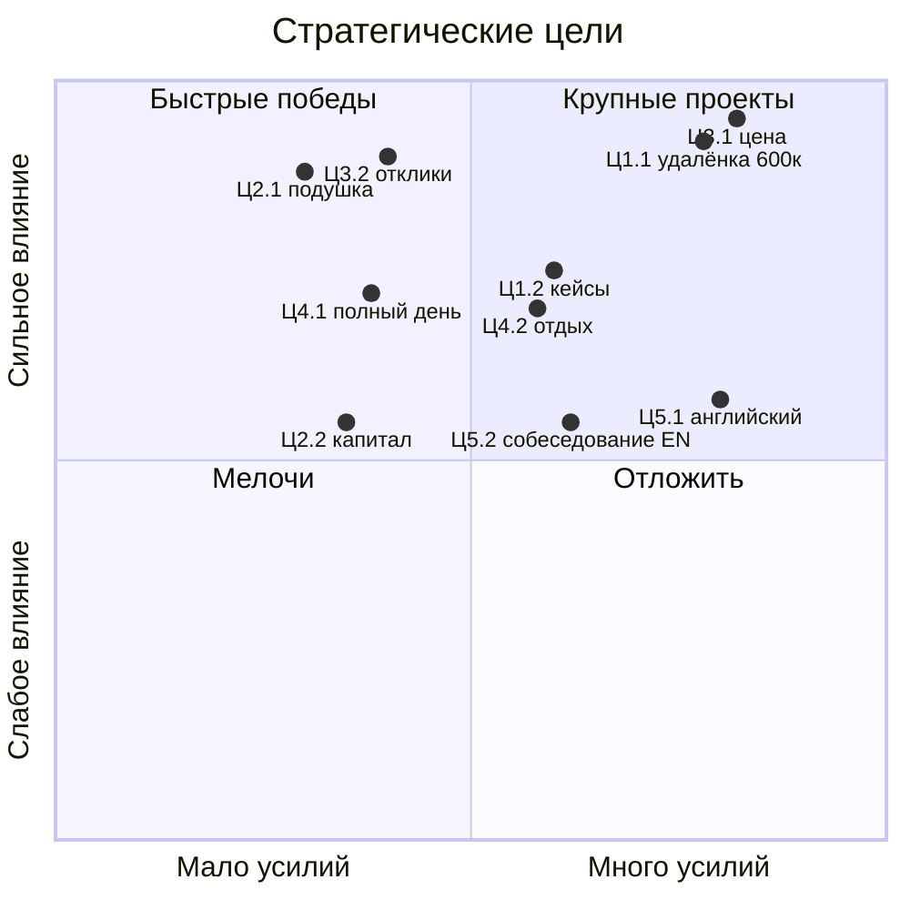

---
tags:
  - mark/addition/practice
status: 🟦
source:
  - "[[Стратегия без иллюзий_ Как управлять своей жизнью, чтобы обрести устойчивость и достигать большего в условиях перемен]]"
description: "Задания 4.1–4.3: образ себя через 2–5 лет, ориентиры с трендами, стратегические цели, их проверка и приоритизация"
summary:
icon: 💪
color: "#7cbf7a"
created: 2026-11-07T15:30:09+04:00
updated: 2026-11-10T15:10:48+04:00
---

> [!toc]+
> ```table-of-contents
> ```

Задания части 4 из [[Стратегия без иллюзий конспект|конспекта]]. Опираются на [[Формирование желаемого будущего#✅ Сильная версия меня|сильную версию меня]] (2036), [[сбор и приоритизация стратегических разрывов#Итог|приоритеты разрывов]], [[Карта трендов|карту трендов]] и черновик целей из [[постановка стратегических целей]]. Проверки, уже сделанные там, здесь не повторяются, только ссылки на них.

## Задание 4.1. Промежуточный образ через 2–5 лет

> [!quote]- Задание
> Перенеситесь на 2–5 лет вперёд. Какую позицию вы занимаете? Какие разрывы устойчивости уже закрыты? Какие вызовы начали преодолевать? Как вы себя ощущаете эмоционально, финансово, социально?
>
> Дополните параметры: роль в обществе, локация, ресурсы, стратегические активы, личностные качества, навыки, знания и экспертность, карьера и денежный поток, с кем конкурируете.
>
> Добавьте несколько предложений: "Я через 2–5 лет – это человек, который…"

### Ответы на вопросы

> [!todo]- Ответы 2026-11-07: гипотезы
> Точка – конец 2029, мне 33. Это середина пути между сегодня и образом 2036.
>
> - **Позиция.** Удалённый фронтенд-разработчик с ИИ-интеграциями в найме, уровень мидл+ или сеньор. Получаю от 600 000 драм в валюте. Найм выполнил роль моста: стабильность есть, своё дело ещё не начато.
> - **Закрытые разрывы.**
> 	- *К2:* доход выше расходов, подушка на 6 месяцев, кредит закрыт.
> 	- *К3:* полный рабочий день без провала после 15:00, вечер – отдых без "заслужить".
> 	- *К1:* закрыт наполовину. Цену и отклики делаю без ступора, а публичность пока впереди.
> - **Начатые вызовы.**
> 	- *1. ИИ до денег:* три кейса с цифрами "было/стало".
> 	- *4. Свои каналы:* найм плюс один-два прямых клиента.
> 	- *5. Валюта и капитал:* доход в валюте, капитал начат, налоги понятны.
> 	- *7. Неспешность:* работаю полный день, но не до 20:23.
> 	- Японский идёт фоном как вечерний досуг.
> - **Ощущения.**
> 	- *Финансово:* спокойно. Нет мысли "не прокормлю себя".
> 	- *Эмоционально:* меньше тревоги, отказ – эпизод, а не приговор.
> 	- *Социально:* Ника рядом. Пара коллег, с которыми можно обсудить работу.

### Параметры

> [!todo]- Ответы 2026-11-07: гипотезы
> - **Роль в обществе.** Инженер, который доводит ИИ до продакшена, а не до демки. В команде к нему идут с вопросом "как сделать это с LLM".
> - **Локация.** Армения: Дилижан или Ереван, с ВНЖ. Япония – цель на 2035+, не на этот горизонт.
> - **Ресурсы.** Подушка на 6 месяцев, начатый капитал, нормальное рабочее место, свободные вечера.
> - **Стратегические активы.** Три кейса с ИИ в проде, сильное резюме, легальная база и ИП в Армении, английский B2, репутация в [[flowing-abbyss]] и Threads.
> - **Личностные качества.** Называю цену первым. Довожу до конца даже без внешней даты. Держу режим. Разрешаю себе отдых.
> - **Навыки и умения.** TypeScript и React на уровне сеньора. Интеграции LLM: агенты, инструменты, RAG. Оценка качества и стоимости ИИ-фич. Работа в паре с агентами.
> - **Знания и экспертность.** Как ИИ-фича окупается: стоимость запросов, надёжность, безопасность данных, эффект "было/стало".
> - **Карьера и денежный поток.** Зарплата в найме в валюте плюс один-два прямых клиента. Ни один источник не обнуляет остальные.
> - **С кем конкурирую.** С удалёнными фронтендерами из СНГ и Восточной Европы. С агентами на типовых задачах. С ИИ-инженерами на Python, у которых нет продуктового фронтенда. Моё отличие – фронтенд плюс ИИ плюс понимание денег клиента.

### Я через 2–5 лет

> [!todo]- Ответы 2026-11-07: гипотезы
> Я через 2–5 лет – это человек, который зарабатывает удалённо в валюте, делая фронтенд с ИИ, который приносит деньги. Я сам называю свою цену, и отказ меня не останавливает. У меня есть подушка и начатый капитал, поэтому мысли о деньгах не съедают день. Я работаю полный день и при этом отдыхаю вечером без вины. Рядом Ника, японский идёт в удовольствие, а своё дело и переезд в Японию – следующий этап, к которому уже есть фундамент.

## Задание 4.2. Ориентиры на 2–5 лет

> [!quote]- Задание
> Выделите 5–7 стратегических ориентиров, которые приведут к образу через 2–5 лет. Сформулируйте их короткими фразами. Рядом с каждым добавьте тренды, за которыми нужно следить, и 1–2 ключевых источника.

> [!todo]- Ответы 2026-11-07: гипотезы
> Тренды взяты из [[Карта трендов|карты трендов]].
>
> | Ориентир                                       | Тренды                                                                                                                                                                                                                             | Источники                                                                     |
> |--------------------------------------------------------|------------------------------------------------------------------------------------------------------------------------------------------------------------------------------------------------------------------------------------------|----------------------------------------------------------------------------------------|
> | **О1. Фронтенд + ИИ**                       | Агенты почти полностью решают типовые задачи программирования. ИИ используют почти все компании, но эффект на прибыль видят 37% | [Stanford AI Index](https://hai.stanford.edu/ai-index), [Anthropic Economic Index](https://www.anthropic.com/economic-index) |
> | **О2. Финансовая устойчивость** | Реформа ВНЖ и требований к ИП в Армении. Курс драма к доллару                                                                                                                           | [permits.am](https://permits.am), курсы ЦБ Армении             |
> | **О3. Смелость перед оценкой**    | Найм джунов падает, в профессию входят через кейсы. Живой человек ценнее ИИ-контента                                                                               | [LeadDev](https://leaddev.com), Threads                                    |
> | **О4. Восстановление**                  | Выгорание в гонке за ИИ-окном: сценарий "Золотая лихорадка"                                                                                                                              | дневник, [[Владимир Кравчук психолог\|психолог]]                                |
> | **О5. Английский**                          | Удалёнка не откатилась. Валютные вакансии требуют английский                                                                                                                        | [Fortune о данных удалёнки](https://fortune.com/2026/07/05/remote-work-data-shows-hybrid-and-flexible-work-), вакансии LinkedIn                  |
> | 📃 **О6. Тело и здоровье**               | Свой тренд: мигрени и сидячая работа                                                                                                                                                                       | дневник                                                                         |
>
> - **Своё дело с лицом** сюда не входит: оно стартует после стабильного дохода ([[поиск и анализ стратегических разрывов#Итог: что беру в работу до 20.11|решение 03.11]]).
> - **Японский** – досуг, не ориентир.
> - **О6** – кандидат, пока ты не решил, нужно ли тело в целях.

## Задание 4.3. Стратегические цели

> [!quote]- Задание
> Под каждым ориентиром выпишите 5–7 целей без фильтрации, как внутреннее стремление, а не [[SMART]]. Отдельно выделите адаптивные перемены: цели, которые выглядят понятными, но вызывают напряжение или страх. Каждую цель проверьте блоками "Реально ли?", "Что/кто поможет?", "Что и когда?". Выберите по 2–3 цели на ориентир. Приоритизируйте по усилиям и влиянию, выделите топ-5 и топ-3. Отложите список на 2–3 дня и проверьте его.

### Цели без фильтрации

> [!todo]- Ответы 2026-11-07: гипотезы
> ⭐ – выбранные 2–3 на ориентир. 🔶 – адаптивная перемена: понятно, что делать, но страшно.
>
> **О1. Фронтенд + ИИ**
> - ⭐ **Ц1.1.** Работать удалённо фронтенд-разработчиком с ИИ-интеграциями за 600 000 драм в валюте к концу 2028.
> - ⭐ **Ц1.2.** Иметь три кейса с ИИ в проде и цифрами "было/стало" к концу 2027.
> - **Ц1.3.** Получить первый удалённый оффер не ниже 300 000 драм на руки к лету 2027.
> - **Ц1.4.** Разобраться, как проверять качество и стоимость ИИ-фич, – то, что мешает малому бизнесу доверять ИИ.
> - 🔶 **Ц1.5.** Стать в команде человеком, к которому идут с вопросами про LLM.
> - **Ц1.6.** Держать TS и React в форме для технических собеседований.
>
> **О2. Финансовая устойчивость**
> - ⭐ **Ц2.1.** Доход стабильно выше расходов и подушка на 3, затем на 6 месяцев.
> - ⭐ **Ц2.2.** Понять налоги и юрисдикцию валютного дохода и каждый месяц откладывать в капитал.
> - **Ц2.3.** Держать минимум два источника дохода: найм и клиент.
> - **Ц2.4.** Закрыть кредит по графику и не брать новых.
> - **Ц2.5.** Освоить базу низкорискового инвестирования к 2028.
> - **Ц2.6.** Снизить постоянные расходы: аренда и коммуналка – 62%.
>
> **О3. Смелость перед оценкой**
> - ⭐🔶 **Ц3.1.** Сам первым называть цену.
> - ⭐🔶 **Ц3.2.** Откликаться и проходить собеседования ровным темпом, не останавливаясь после отказов.
> - 🔶 **Ц3.3.** Назвать новую ставку текущим клиентам.
> - 🔶 **Ц3.4.** Засчитывать свои результаты, а не обесценивать их ([[паттерн недоприсвоения результатов]]).
> - 🔶 **Ц3.5.** Показывать работу до "идеала": отправлять демо, не дожидаясь 100%.
> - 🔶 **Ц3.6.** Вести Threads открыто. *Отложено до стабильного дохода.*
>
> **О4. Восстановление**
> - ⭐ **Ц4.1.** Выдерживать полный рабочий день без провала после 15:00.
> - ⭐🔶 **Ц4.2.** Отдыхать вечером без "заслужить": без работы и хранилища.
> - **Ц4.3.** Держать подъём и сон.
> - 🔶 **Ц4.4.** Говорить людям о недовольстве и усталости вовремя, а не глотать.
> - **Ц4.5.** Меньше дней с мигренью.
>
> **О5. Английский**
> - ⭐ **Ц5.1.** Английский B2 к концу 2027.
> - ⭐🔶 **Ц5.2.** Пройти собеседование на английском к Q3 2027.
> - **Ц5.3.** Читать документацию и статьи без перевода.
> - **Ц5.4.** Регулярная разговорная практика.
> - **Ц5.5.** Пройти тест уровня в ноябре 2026. *Операционная.*
>
> 📃 **О6. Тело и здоровье**
> - **Ц6.1.** 80–85 кг с видимыми мышцами к 2030.
> - **Ц6.2.** Тренироваться регулярно, без надзирателя.
>
> **Адаптивные перемены.** Почти все лежат в О3: это один страх оценки в разных формах. Значит, кроме самих целей нужен навык, а не только дисциплина. Работа с психологом и правило "считаю отправленное, а не ответы" – это и есть развитие внутренней адаптации.

### Проверка выбранных целей

Ц1.1, Ц1.2, Ц2.1, Ц3.1, Ц4.1 и Ц5.1 уже проверены в [[постановка стратегических целей#Проверка целей|разборе теории]]. Ниже – остальные выбранные.

> [!todo]- Ц2.2. Налоги и капитал
> - **Реально ли?** Да. Неопределённость – реформа ВНЖ и ИП с 01.11.2026 и то, где оформлять доход от найма.
> - **Поможет:** финансовая дисциплина, [[Месячный бюджет]], легальная база в Армении, бухгалтер.
> - **Достигнута, когда:** знаю, где и сколько плачу налогов, и полгода подряд откладываю в капитал.
> - **Проекты:** консультация бухгалтера при первом оффере, автоперевод в капитал в день дохода.
> - **Решения:** ИП или другая форма для валютного дохода, процент в капитал.
> - **Сроки:** налоги – вместе с первым оффером, Q2 2027. Капитал – после подушки на 3 месяца, Q4 2027.

> [!todo]- Ц3.2. Отклики без остановки после отказов
> - **Реально ли?** Да, но в прошлый раз 200+ откликов на Java закончились стопом. Риск – выгореть на количестве.
> - **Поможет:** внешняя дата (критерии к 20.11), резюме "фронтенд + ИИ", демо и Sladko, психолог.
> - **Достигнута, когда:** три месяца подряд 30 откликов в неделю без пропущенных недель, и все тестовые сделаны.
> - **Проекты:** трекер откликов, разбор каждого собеседования, фиксированное утреннее окно.
> - **Решения:** темп ниже 30 в неделю, если начнётся выгорание, а не стоп.
> - **Сроки:** старт – ноябрь 2026, привычка – Q1 2027.

> [!todo]- Ц4.2. Отдых без "заслужить"
> - **Реально ли?** Да. Это адаптивная перемена: мешают ценности-надзиратели "Продуктивная жизнь" и "Высокие запросы".
> - **Поможет:** [[легитимизация отдыха]], японский как досуг без критериев, психолог.
> - **Достигнута, когда:** месяц подряд вечера без работы и хранилища, и нет вины за это.
> - **Проекты:** фиксированный конец рабочего дня, вечерний список того, что радует.
> - **Решения:** когда заканчивается рабочий день.
> - **Сроки:** Q1 2027.

> [!todo]- Ц5.2. Собеседование на английском
> - **Реально ли?** Зависит от стартового уровня. Это двойная оценка: язык и профессия сразу.
> - **Поможет:** ИИ как партнёр для пробных собеседований, Ц3.2 – собеседования на русском как тренировка.
> - **Достигнута, когда:** прошёл собеседование на английском до конца, независимо от результата.
> - **Проекты:** тест уровня, пробные собеседования с ИИ, отклик на одну зарубежную вакансию.
> - **Сроки:** первое пробное – Q1 2027, настоящее – Q3 2027.

### Приоритизация

> [!todo]- Ответы 2026-11-07: гипотезы
> | Цель                                                    | Усилия | Влияние | Квадрант            |
> |-------------------------------------------------------------|--------------|----------------|-----------------------------|
> | Ц1.1. Удалёнка на 600 000                        | 4            | 5              | крупный проект |
> | Ц1.2. Три кейса                                    | 3            | 4              | крупный проект |
> | Ц2.1. Доход выше расходов, подушка | 2            | 5              | быстрая победа |
> | Ц2.2. Налоги и капитал                       | 2            | 3              | быстрая победа |
> | Ц3.1. Сам называю цену                       | 4            | 5              | крупный проект |
> | Ц3.2. Отклики без остановки             | 2            | 5              | быстрая победа |
> | Ц4.1. Полный день                                | 2            | 4              | быстрая победа |
> | Ц4.2. Отдых без "заслужить"               | 3            | 4              | крупный проект |
> | Ц5.1. Английский B2                              | 4            | 3              | крупный проект |
> | Ц5.2. Собеседование на английском | 3            | 3              | крупный проект |



### Выбор

> [!todo]- Ответы 2026-11-07: гипотезы
> **Топ-5 по эффекту:** Ц1.1, Ц3.1, Ц3.2, Ц2.1, Ц4.1.
>
> **Топ-3, с которых начинаю:**
> 1. **Ц3.2. Отклики без остановки.** Старт уже в ноябре, это путь к Ц1.1.
> 2. **Ц3.1. Сам называю цену.** Первая проверка – новая ставка клиенту до 20.11.
> 3. **Ц2.1. Доход выше расходов.** Закрывается через первые две и новую ставку.
>
> **Главная по смыслу – Ц1.1,** но начинается она не с себя, а с Ц3.2. Это то же, что решено в части 3: найм – главный разрыв, смелость – его условие.

## Созревание и корректировка

> [!question]- Вернуться во вторник 10.11
> - Ведут ли эти цели к образу через 2–5 лет и к [[Формирование желаемого будущего#✅ Сильная версия меня|сильной версии меня]]?
> - Устраняют ли они мои стратегические разрывы?
> - Чувствую ли я к ним напряжение и интерес?
> - Обсудить по желанию: [[Кирилл Мегацукан|Кирилл]] (рынок и найм), [[Владимир Кравчук психолог|психолог]] (адаптивные цели О3).

> [!success]- Отметить
> Большая часть личного стратегического процесса пройдена. Не каждый доходит до этой точки.

## Вопросы для проверки

> [!question]- 📃 Ответь своими словами
> 1. Точка образа – конец 2029. Подходит, или взять ближе, 2028, где стоят 600 000?
> 2. Локация через 2–5 лет – Армения. Верно, или есть другой вариант?
> 3. О6 "Тело и здоровье" оставить ориентиром или убрать?
> 4. Какой у тебя сейчас уровень английского?
> 5. 600 000 драм – на руки или до налогов?
