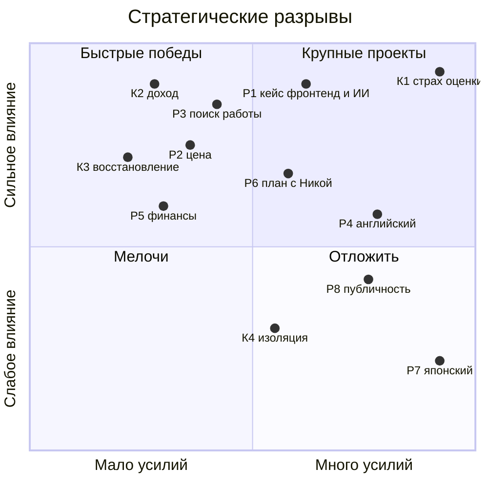
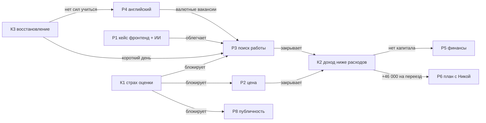

---
tags:
  - mark/addition/practice
status: 🟩
source:
  - "[[Стратегия без иллюзий_ Как управлять своей жизнью, чтобы обрести устойчивость и достигать большего в условиях перемен]]"
description: "Задания 3.1–3.3: итоговые разрывы устойчивости, разрывы развития из вызовов и приоритизация по усилию и влиянию"
summary: "Главный разрыв: найм фронтенд + ИИ на 600 000 драм к 2028. Топ-3: найм, К1 как правило считать действие, финансовый фундамент. Английский сейчас, японский как досуг без критериев."
icon: 💪
color: "#7cbf7a"
created: 2026-11-03T12:02:27+04:00
updated: 2026-11-03T12:51:26+04:00
---

> [!toc]+
> ```table-of-contents
> ```

Задания части 3 из [[Стратегия без иллюзий конспект|конспекта]]. Сбор проблем, чистка и дерево причин уже сделаны в [[поиск и анализ стратегических разрывов]], здесь не повторяются. Здесь цепочки "почему", разрывы развития из вызовов в [[Формирование желаемого будущего#Задание 1.5. Формирование стратегических вызовов|1.5]] и приоритизация.

## Задание 3.1. Разрывы устойчивости

> [!quote]- Задание
> Пройдитесь по всем блокам анализа текущей ситуации. Сформулируйте проблемы своими словами, максимально конкретно: "Боюсь конфликтов → Не умею отстаивать свою позицию". Найдите корневые причины методом [[пять почему|пяти почему]]. Сгруппируйте, уберите дубли, составьте итоговый список разрывов устойчивости.

Сбор по блокам (П1–П40) и чистка лежат в [[поиск и анализ стратегических разрывов#Шаг 1. Сбор проблем по блокам|шаге 1]] и [[поиск и анализ стратегических разрывов#Шаг 2. Чистка: симптомы, части, повторы|шаге 2]]. Не хватало цепочек "почему", поэтому они ниже.

### Пять почему

> [!todo]- Ответы 2026-11-03: гипотезы
> Цепочки собраны из фактов [[оценка текущей ситуации|оценки]]. Если на каком-то "почему" ответ другой, перепиши звено, и дальше цепочка пойдёт иначе.
>
> **К1. Не пишу людям, которые могут меня оценить**
> - Не отправил демо клиентам в октябре → почему? → Каждое сообщение – шанс услышать "нет".
> - Почему "нет" так страшно? → Отказ читается как "ты не эксперт", а не как "сейчас не нужно".
> - Почему отказ = "не эксперт"? → Ценность себя держится на восхищении моей экспертизой, другой опоры нет.
> - Почему другой опоры нет? → "Мои результаты не считаются" ([[паттерн недоприсвоения результатов]]): сделанное не копится в уверенность.
> - Почему не копится? → Успех не засчитывается внутри, а эмоции не выражаются людям вовремя. Наедине, в дневнике, я их называю, а при других глотаю, особенно при тех, от кого завишу ([[periodic/daily/2026-03-24|24.03]]: "удовлетворения не чувствую, чувствую себя самозванцем"; [[periodic/daily/2025-09-17|17.09.2025]]: "придется отмолчаться"). Дальше – зона психолога.
> - **Формулировка:** Боюсь оценки → Не довожу до конца то, где меня оценивают и нет внешней даты.
>
> **К2. Трачу больше, чем зарабатываю**
> - Дефицит ~10% второй месяц → почему? → Доход ~267 000, расходы ~293 500 драм.
> - Почему доход такой? → Один канал заказов и низкий чек.
> - Почему чек низкий? → Не называю цену заранее и боюсь "потерять канал" – это К1 в денежной форме.
> - Почему расходы такие? → Аренда и коммуналка – 62%, кредит 44 000. Это цена переезда, а не транжирство.
> - **Формулировка:** Боюсь назвать цену → Доход не растёт, а постоянные расходы уже заданы переездом.
>
> **К3. Рабочий день заканчивается в 15:00**
> - После 15:00 нет сил → почему? → Сон сбит, подъём в 7:00 не держится.
> - Почему сбит? → Вечер пустой: отдыха, который восстанавливает, нет, и я досиживаю допоздна.
> - Почему отдых не восстанавливает? → "Отдых надо заслужить", поэтому вместо него хранилище или тревога.
> - Почему надо заслужить? → Ценности-надзиратели "Продуктивная жизнь" и "Высокие запросы", самоконтроль 10 / 8.
> - Почему не отдыхаю открыто? → Эмоции не выражаются людям вовремя. Усталость и недовольство при других глотаю: "меня терпят, пока я полезен" ([[легитимизация отдыха]], п. 7). Наедине называю, вслух нет, и отдых в итоге выписывает тело, мигренью.
> - **Формулировка:** Отдых надо заслужить → Не восстанавливаюсь, и на страшные дела не остаётся сил.
>
> **К4. Изоляция**
> - Не с кем разделить тревогу → почему? → В Дилижане никого, с Никой о деньгах молчу.
> - Почему молчу? → "Нельзя показываться настоящим" – снова К1.
> - **Формулировка:** Нельзя показывать слабость → Тревогу несу один. *Отложено по решению 2026-11-03.*
>
> **Вывод.** Все четыре цепочки на третьем-четвёртом "почему" выходят в К1 или в невыраженные при людях эмоции. Значит, К1 – не один из четырёх разрывов, а общий корень.

### Итоговый список разрывов устойчивости

> [!todo]- Ответы 2026-11-03: гипотезы
> 1. **К1. Страх оценки.** Ценность себя привязана к экспертизе, поэтому избегаю всего, где меня оценивают: продаж, откликов, цены, публичности.
> 2. **К2. Доход ниже расходов.** Один канал, низкий чек, высокие постоянные расходы. Дефицит ~10%.
> 3. **К3. Восстановление не работает.** Отдых надо заслужить, эмоции при других не выражаются. Отсюда короткий день, сбитый режим, мигрени.
> 4. **К4. Изоляция.** Не в приоритете.

## Задание 3.2. Разрывы развития

> [!quote]- Задание
> Посмотрите на ви́дение будущего и список стратегических вызовов. Выберите 3–5 вызовов, которые готовы принять. Для каждого определите: каких навыков не хватает, чего не умеете или не понимаете, какие решения придётся принимать, какие качества нужно развить. Сразу отметьте, если вызов содержит разрывы устойчивости.

### Выбор вызовов

> [!todo]- Ответы 2026-11-03: гипотезы
> Отбор с учётом [[поиск и анализ стратегических разрывов#Итог: что беру в работу до 20.11|решения 2026-11-03]]: сначала найм, потом своё.
>
> **Беру:**
> - ✅ **1. "Доведу ИИ до денег – или стану заменяемым кодером".** Прямо ведёт к позиционированию "фронтенд + ИИ".
> - ✅ **4. "Построю свои каналы дохода – или буду зависеть от одного заказчика".** Найм и есть второй канал.
> - ✅ **5. "Выведу доход в валюту и соберу капитал – или Япония останется картинкой".** На 2–5 лет это не Япония, а капитал и валюта.
> - ✅ **7. "Сохраню неспешность и близость – или потеряю то, ради чего бежал".** Без него найм съест здоровье и Нику.
>
> **Не беру сейчас:**
> - **2. "Выйду к людям лицом".** Отложено до стабильного дохода (решение 2026-11-03).
> - **3. "Выберу узкую нишу".** Ниша проверяется кейсами, а кейсы появятся из вызова 1. Сам вызов вернётся после третьего кейса.
> - **6. "Японский до рабочего уровня".** Не как разрыв, а как досуг: начинаю сейчас, вечерами, без критериев и чек-листов (ответ на вопрос 3).

### Разрывы по каждому вызову

> [!todo]- Ответы 2026-11-03: гипотезы
> **Вызов 1. Доведу ИИ до денег**
> - *Навыки:* нет коммерческого проекта с ИИ-интеграцией в проде, только демо и [[Sladko brno]].
> - *Не понимаю:* как считать эффект в деньгах клиента, "было/стало".
> - *Решения:* найм или своё – принято, найм как мост на год.
> - *Качества:* доводить до конца, когда оценивают.
> - → **Р1. Нет кейса и позиционирования "фронтенд + ИИ" для дорогого найма.** Это бывший К5.
> - ⚠ Устойчивость: К1 (показать демо = быть оценённым).
>
> **Вызов 4. Свои каналы дохода**
> - *Навыки:* нет системы поиска работы. Был взрыв из 200+ откликов на Java, потом стоп.
> - *Не умею:* называть и защищать цену.
> - *Решения:* какие 2–3 канала держать одновременно: найм, текущие клиенты, позже своё.
> - *Качества:* смелость в цене (ценность 17 / 2).
> - → **Р2. Не умею называть и защищать цену.**
> - → **Р3. Нет системы поиска работы:** отклики, тестовые, собеседования ровным темпом.
> - ⚠ Устойчивость: К1 и К2. Пока дефицит, любое "нет" бьёт сильнее.
>
> **Вызов 5. Валюта и капитал**
> - *Навыки:* английский ниже B2 закрывает зарубежные и валютные вакансии.
> - *Не понимаю:* налоги и юрисдикцию дохода: армянское ИП, [[резидентство как инфраструктура дохода|резидентство]].
> - *Решения:* где оформлять доход, сколько откладывать.
> - *Качества:* финансовая дисциплина, капитал, а не только доход.
> - → **Р4. Английский ниже B2.**
> - → **Р5. Нет финансовой системы:** подушки, капитала, понимания налогов.
> - ⚠ Устойчивость: К2. Пока расходы выше доходов, капитала не будет.
>
> **Вызов 7. Неспешность и близость**
> - *Навыки:* не умею отдыхать без "заслужить" и выражать эмоции.
> - *Не умею:* говорить с Никой о деньгах и страхах.
> - *Решения:* где и как жить вместе: пробный визит, без давления.
> - *Качества:* разрешать себе отдых и показывать себя настоящим.
> - → **Р6. Нет общего плана с Никой:** о деньгах молчу, решения о совместной жизни нет.
> - ⚠ Устойчивость: К3 (почти совпадает с ним), К4, К2 (переезду Ники нужно +46 000 в месяц).
>
> **Вне выбранных вызовов**, для полноты карты: Р7. Японский с нуля. Р8. Не показываю себя публично.

## Задание 3.3. Приоритизация

> [!quote]- Задание
> Объедините два списка. Оцените каждый разрыв по усилиям и влиянию. Сделайте распределение по четырём квадрантам. Выделите связи между разрывами. Выберите топ-5 на средний горизонт (2–5 лет), из них топ-3 и один главный.

### Оценка

> [!todo]- Ответы 2026-11-03: гипотезы
> Шкала 1–5. Влияние – насколько приближает к [[Формирование желаемого будущего#✅ Сильная версия меня|сильной версии меня]] за 2–5 лет.
>
> | Разрыв                                  | Усилия | Влияние | Квадрант            |
> |-----------------------------------------------|--------------|----------------|-----------------------------|
> | К1. Страх оценки                  | 5            | 5              | крупный проект |
> | К2. Доход ниже расходов     | 2            | 5              | быстрая победа |
> | К3. Восстановление             | 2            | 4              | быстрая победа |
> | К4. Изоляция                         | 3            | 2              | отложить            |
> | Р1. Кейс "фронтенд + ИИ"       | 3            | 5              | крупный проект |
> | Р2. Цена                                 | 2            | 4              | быстрая победа |
> | Р3. Система поиска работы | 2            | 5              | быстрая победа |
> | Р4. Английский B2                  | 4            | 3              | крупный проект |
> | Р5. Финансовая система      | 2            | 3              | быстрая победа |
> | Р6. План с Никой                   | 3            | 4              | крупный проект |
> | Р7. Японский                         | 5            | 2              | отложить            |
> | Р8. Публичность                   | 4            | 3              | отложить            |



### Связи



> [!todo]- Ответы 2026-11-03: гипотезы
> - **Устойчивость тянет развитие:** К1 блокирует сразу три разрыва развития (цена, поиск, публичность). К2 держит в заложниках финансы и Нику.
> - **Развитие закрывает устойчивость:** Р2 и Р3 – это способ закрыть К2. Отдельно чинить "доход" не нужно, он чинится через цену и найм.
> - **Р1 – рычаг:** готовый кейс делает каждый отклик сильнее, то есть уменьшает число "нет" и косвенно облегчает К1.

### Выбор

> [!todo]- Ответы 2026-11-03: гипотезы
> На 2–5 лет (2028–2031) объединил то, что на этом горизонте одно и то же: Р3 входит в Р1 (найм и есть поиск), К2 и Р5 – в "финансовый фундамент", Р2 – в К1 (цена – его денежная форма).
>
> **Топ-5:**
> 1. **Р1. Дорогой найм "фронтенд + ИИ".** От ~267 000 к 600 000 драм в месяц к 2028, удалённо, в валюте.
> 2. **К1. Страх оценки,** включая цену.
> 3. **Финансовый фундамент (К2 + Р5).** Доход выше расходов → подушка → капитал.
> 4. **К3. Восстановление.** Без него найм с полным днём не выдержать.
> 5. **Р4. Английский B2.** Открывает зарубежный и валютный найм. Начинаю сейчас (ответ на вопрос 4).
>
> **Топ-3:** Р1, К1, финансовый фундамент.
>
> **Главный: Р1. Дорогой найм "фронтенд + ИИ".** Он совпадает с [[поиск и анализ стратегических разрывов#Итог: что беру в работу до 20.11|решением 2026-11-03]] и с твоей сноской в конспекте про работу на 600 000 драм. Из него вытекает стратегическая цель. К1 – не соперник, а обязательное условие: без него Р1 повторит историю с 200+ откликами на Java.

## Вопросы для проверки

> [!question]- 📃 Ответь своими словами
> 1. Звено про эмоции уточнено 2026-11-03: они не выражаются людям вовремя, а не "не проживаются". Связь с мигренями держится только на инсайте 22.08. Проверишь её с психологом или неврологом?
> 	1. Нет, пока не в приоритете
> 2. Главным выбран Р1 (найм), а К1 стал условием. Согласен, или главным должен быть сам К1? Влияние у него выше, но он не даёт цели, только снимает барьер.
> 	1. Сначала нужны деньги, без этого никуда.
> 3. Японский: начинаешь в эти 2–5 лет или после 2031? Если позже – N2 к 2035 почти нереален, и план [[Переезд в Японию|переезда]] сдвигается.
> 	1. Начинаю. Я планирую его использовать в качестве досуга, без использования [[стимул|стимулов]], чисто на мотивации(то есть без критериев успеха, без чек-листов, чисто на порывах вечерами)
> 4. Английский попал в топ-5. Готов давать ему время уже сейчас, или только после закрытия К2?
> 	1. Готов, чем раньше начну, тем быстрее результат
> 5. 600 000 драм – это цель к какому году?
> 	1. К 2028

## Проверка ответов

> [!check]- Разбор 2026-11-03
> **1. Мигрени не проверяю.** Принято. Тогда связь "невыраженные эмоции → мигрени" в цепочке К3 остаётся гипотезой, и решения на ней не строим.
>
> **2. "Сначала нужны деньги".** Принято, главный разрыв – Р1. Одна поправка из сегодняшнего дня: К1 мешает не только найму, но и любым денежным шагам. Поход за банковской картой ([[страх открытия банковского счёта]]) – тот же страх оценки. Поэтому К1 не отдельный проект, а правило внутри Р1: считаю отправленное и сделанное, а не ответы.
>
> **3. Японский как досуг.** Хорошее решение. Оно работает на К3: появляется вечернее удовольствие без надзирателя. Два 📃:
> - Без критериев N2 к 2035 не гарантирован. Если это принято, переезд в Японию держится на капитале и найме, а не на языке. Это совпадает с путём А из [[Формирование желаемого будущего#Развилка: как въехать в Японию|развилки]].
> - Риск: ценность "Высокие запросы" может превратить досуг в обязанность. Признак – вина за пропущенный вечер. Тогда неделю не учить совсем.
>
> **4. Английский сейчас.** Это меняет решение "до 20.11 не трогать" из [[поиск и анализ стратегических разрывов#Проверка ответов|прошлой проверки]]. Риск один: английский не должен занимать утреннее окно, где идут 5 откликов в день. Отклики первыми, английский после. Японский вечером, английский не вечером, чтобы досуг остался досугом.
>
> **5. 600 000 драм к 2028.** Это около $1 500 в месяц (курс примерно на 2026, перепроверь). Для удалённого мидла "фронтенд + ИИ" это средняя, а не рекордная зарплата. Значит, узкое место не в рынке, а в числе откликов и собеседований, то есть снова в К1.

## Итог

> [!success]+ Приоритеты на 2–5 лет
> - **Главный разрыв: Р1.** Найм "фронтенд + ИИ" на 600 000 драм к 2028.
> - **Топ-3:** Р1, К1 как правило "считаю действие", финансовый фундамент (К2 + Р5).
> - **Топ-5:** плюс К3 восстановление и Р4 английский, который начинается сейчас.
> - **Досуг, а не цель:** японский вечерами, без критериев.
> - **Отложено:** К4 изоляция, Р8 публичность, проверка связи эмоций и мигреней.
