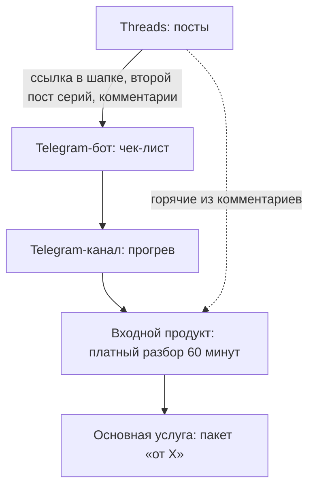

---
tags:
  - note/basic/primary
aliases:
deck:
cssclasses:
icon: 📝
color: "#70a0b5"
created: 2026-11-02T12:47:01+04:00
updated: 2026-11-02T12:47:01+04:00
---

Воронка продаж услуг через Threads и Telegram — путь от поста до проекта, в котором между постом и покупкой стоит ступенька доверия: бесплатный материал, прогрев и недорогой входной продукт. Незнакомцу проект за десятки тысяч не продают, а разбор за фиксированную цену — продают.

Схема взята из разбора [[разбор threads pure.writing — как продавать через threads]] и адаптирована под услуги: у pure.writing в конце мини-продукты в записи, у услуг — личная работа, поэтому нужен входной продукт.

## Этапы

### 1. Threads — охват и первый контакт

Задача поста — увести человека в Telegram, а не собрать лайки. Три пути:
- **ссылка в шапке** на бесплатный материал — основной;
- второй пост серии: «Схемы из этой ветки собрал в чек-лист → t.me/…»;
- призыв в комментарии: «Узнали себя? Пишите, подскажу». Ответившим — в личку, это самые горячие.

### 2. Бот — точка входа

«Старт» → чек-лист «10 рутин, которые автоматизируются за вечер» → предложение подписаться на канал.

- После выдачи — 2–3 вопроса: какой бизнес, что отнимает больше всего времени. Сегментация и темы для постов.
- Через 2–3 дня одно сообщение: «Удалось что-то внедрить? Если хотите, разберу вашу ситуацию — [кнопка]».
- Бот сам по себе витрина: человек видит работающую автоматизацию. Позже он же становится кейсом.

### 3. Канал — прогрев

2–3 поста в неделю:
- кейсы «было → стало» с цифрами — продают сильнее всего;
- процесс работы: сроки, что нужно от клиента — снимает страх «я не разбираюсь в технике»;
- разборы рутин подписчиков;
- раз в 1–2 недели прямое предложение записаться на разбор.

### 4. Входной продукт — разбор автоматизации, 60 минут

Анкета до встречи → на встрече ищем, где теряются время и заявки → после присылаю схему и смету. **Цена фиксированная и засчитывается в проект.**

Платят только готовые платить, бесплатные консультации всем подряд не раздаются, а после разбора согласиться на проект проще, чем отказаться.

### 5. Основная услуга — пакеты

Пакеты с результатом и ценой «от»: «Бот для заявок из Instagram и Telegram — от X, 2 недели». Пакет продаётся легче, чем «расскажите, сколько стоит сайт».

## Минимальный запуск

Не строить всё сразу — это 2–3 вечера:
1. Чек-лист в Google Doc или Telegraph.
2. Бот или пока просто закреп в канале с чек-листом.
3. Канал с 3–5 постами: кто я, 1–2 кейса, как проходит разбор и сколько стоит.
4. Шапка в Threads со ссылкой.
5. Публикация постов из [[Threads pure.writing (2026-11-02) - practice]].

Раз в неделю: какие посты привели подписчиков в Telegram и заявки на разбор — масштабировать их. Лайки и просмотры не считать.

## Решить до запуска

- **Приём оплаты.** Клиенты в основном из России, я в Армении; Продамус требует самозанятости или ИП в РФ. Пока решения нет — оплата вручную по договорённости.
- **Цена разбора** не символическая: заплативший приходит подготовленным.
- **Ставка.** Перед ценой «от» посчитать, сколько часов реально уходит на типовой бот.
